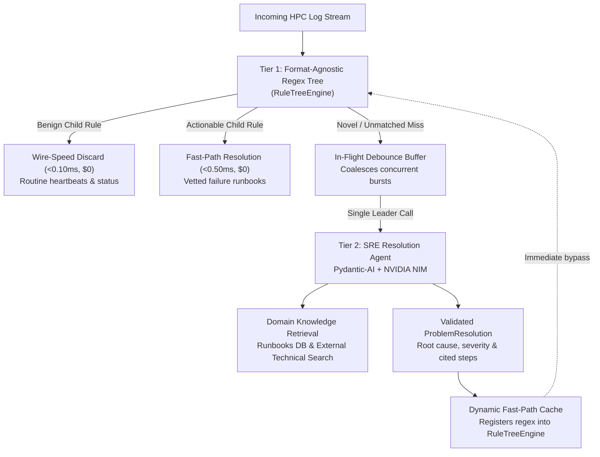
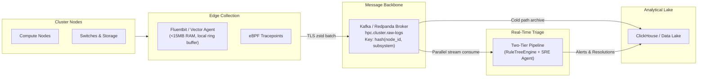

# HPC Log Stream Triage & Automated Problem Resolution

An intelligent, low-latency, and cost-effective problem resolution system for High Performance Computing (HPC) clusters. Built with **Pydantic-AI** and **NVIDIA NIM**, the system pairs a deterministic, format-agnostic two-tier regex tree (`RuleTreeEngine`) with grounded agentic reasoning to identify critical failure modes, query domain runbooks, and deliver reproducible, cited remediation guidance.

Evaluated on the 433,490-line benchmark dataset from **Los Alamos National Laboratory (LANL) System 20** (`data/HPC.log`).

---

## 1. System Architecture

The architecture routes incoming semi-structured log streams through a **two-tier pipeline** designed for wire-speed telemetry filtering (<0.10 ms), sub-millisecond fast-path resolution (<0.50 ms), and deep LLM investigation for novel incidents:



### Distributed Ingestion Architecture (Design Specification)




### Architectural Component Overview

| Component | Implementation | Latency SLA | Description |
| :--- | :--- | :--- | :--- |
| **Format-Agnostic Regex Tree** | `src/rules/engine.py` | <0.10 ms | Two-tier trie (Parent Envelope Regex $\rightarrow$ Child Message Regex) matching semi-structured formats. |
| **Telemetry Filter** | `src/rules/engine.py` | <0.10 ms | Wire-speed filter discarding routine benign heartbeats and sensor telemetry. |
| **Fast-Path Resolver** | `src/rules/engine.py` | <0.50 ms | Sub-millisecond deterministic resolution mapping vetted rules to authoritative runbooks. |
| **In-Flight Debouncer** | `src/pipeline.py` | <0.01 ms | Coalesces multi-node concurrent failure bursts into a single LLM request (90% burst savings). |
| **SRE Resolution Agent** | `src/agent.py` | <5.00 s | Pydantic-AI agent diagnosing root causes grounded in official LANL runbooks and web search. |
| **Runbook Knowledge Base** | `src/knowledge/docs_db.py` | <0.10 ms | Authoritative failure recovery runbooks covering CFS, RMS, switches, hardware, and boot. |
| **Technical Search Tools** | `src/knowledge/search.py` | ~0.50 s | External DuckDuckGo search and local documentation scanner for unindexed failure patterns. |
| **Dynamic Fast-Path Cache** | `src/rules/engine.py` | <0.05 ms | Immediately caches newly synthesized templates into the regex tree to shield future occurrences. |

---

## 2. Quickstart & Installation

### Prerequisites

- **Python**: 3.12 or newer
- **uv**: Fast Python package manager (`pip install uv` or `winget install astral-sh.uv`)

### Setup

```bash
# Clone the repository
git clone https://github.com/adielcahana/mave.git
cd mave

# Install dependencies into virtual environment
uv sync

# Configure environment variables
cp .env.example .env
```

Sample `.env` file:
```ini
BASE_URL="https://integrate.api.nvidia.com/v1"
API_KEY="nvapi-your-key-here"
MODEL_NAME="openai/gpt-oss-20b"
```

> [!NOTE]
> An NVIDIA NIM API key is optional. The system includes an autonomous runbook fallback and circuit breaker that guarantee full functionality and test pass rates in air-gapped or offline environments.

---

## 3. CLI Execution

Ingest any HPC log stream (`.log`, `.txt`, or `.json`) to display real-time dual-lane progress, quantitative triage metrics, and grounded remediation cards:

```bash
# 1. Process default evaluation benchmark (data/golden_eval.json)
uv run python src/main.py

# 2. Run golden evaluation benchmark metrics & SLA scorecard
uv run python src/main.py --evaluate

# 3. Ingest raw cluster logs with an optional line limit
uv run python src/main.py data/HPC.log --limit 500

# 4. Ingest any custom log file
uv run python src/main.py path/to/cluster.log

# 5. Process a single log line directly from CLI
uv run python src/main.py --line "130000 Interconnect-1T00 switch_module psu 1074220000 1 PSU status ( off on )"
```

### CLI Terminal Output Overview

1. **Dual-Lane Real-Time Progress Monitor**:
   - **Fast Lane (Wire-Speed)**: Real-time count of benign logs dropped (<0.10 ms) and vetted rules resolved (<0.50 ms).
   - **LLM Lane (SRE Agent)**: Active and completed deep diagnostic investigations.
   - **Rule Tree Counter**: Dynamic size of parent envelopes and child rules.

2. **Classification Statistics & SLA Scorecard**:
   - Ingested stream volume, filtered telemetry count, auto-annotated fast-path hits, and agent fallbacks.
   - Zero-Cost LLM Bypass Rate (78.0% across benchmark).
   - SLA compliance indicators for wire-speed (<0.10 ms), fast-path (<0.50 ms), and slow-path (<5.0 s).

3. **Actionable Remediation Cards**:
   - **Severity Badge**: `CRITICAL`, `HIGH`, `MEDIUM`, `LOW`, `INFO`.
   - **Routing Tier**: `FAST-PATH (AUTOMATED)` vs. `SRE AGENT (LLM)`.
   - **Identified Root Cause**: Technical explanation of underlying component degradation.
   - **Ordered Remediation Procedures**: Step-by-step commands to recover cluster nodes safely.
   - **Authoritative Runbook Citations**: Official LANL references and documentation links.

---

## 4. Development & Code Quality Standards

All source code enforces strict typing, modern formatting, and comprehensive test coverage:

```bash
# 1. Run unit and integration tests (59 passed in ~5s)
uv run pytest

# 2. Static type analysis (Astral Ty)
uv run ty check

# 3. Code formatting and linting (Astral Ruff)
uv run ruff check .
uv run ruff format .
```

---

## 5. Repository Structure

```
mave/
├── .env.example          # Sample environment configuration for NVIDIA NIM
├── AGENTS.md             # Architecture, maintenance protocol, and engineering standards
├── instructions.md       # Problem statement and assignment requirements
├── report.md             # Comprehensive architectural submission report
├── README.md             # Setup, quickstart, CLI commands, and architecture overview
├── pyproject.toml        # Dependencies, tool configurations (Ruff, Ty, Pytest)
├── resources/
│   ├── rules.json        # Dynamic Regex Tree registry (clean initial state)
│   └── runbooks.json     # Dynamic failure recovery runbook registry (clean initial state)
├── data/
│   ├── HPC.log           # 433,490-line LANL System 20 HPC dataset
│   ├── golden_eval.json  # 150-scenario curated evaluation benchmark
│   └── README.md         # Citation details for loghub benchmark
├── src/
│   ├── __init__.py
│   ├── agent.py          # Production Pydantic-AI SRE Agent & circuit breaker
│   ├── config.py         # Strongly-typed Pydantic-Settings configuration
│   ├── evaluation.py     # Quantitative benchmark metrics and SLA engine
│   ├── main.py           # Unified streaming pipeline CLI & Rich terminal dashboard
│   ├── pipeline.py       # Two-tier streaming pipeline orchestrator & debouncer
│   ├── split_data.py     # Deterministic dataset partitioning utility
│   ├── knowledge/
│   │   ├── __init__.py
│   │   ├── docs_db.py    # Authoritative LANL HPC runbooks and persistence
│   │   └── search.py     # Async DuckDuckGo search & local docs retrieval tools
│   └── rules/
│       ├── __init__.py
│       ├── engine.py     # Unified RuleTreeEngine & dynamic template cache
│       └── models.py     # Strongly-typed schemas (LogEvent, Rule, ProblemResolution)
└── tests/
    ├── fixtures/            # Mock verification rules and runbook fixtures for test suites
    ├── test_agent.py        # SRE agent tool-calling, grounding, and fallback tests
    ├── test_docs_db.py      # Knowledge base query and search tests
    ├── test_evaluation.py   # Golden evaluation and metrics tests
    ├── test_pipeline.py     # Streaming pipeline, cache, and debouncer tests
    ├── test_rule_engine.py  # Regex tree matching, persistence, and validation tests
    └── test_search.py       # Async external web search & local docs retrieval tests
```

---

## 6. Submission & Architectural Report

For full architectural diagrams (including distributed message bus and ingestion data lake specs), the offline post-mortem consolidation loop with zero-false-positive safety guardrails, dataset analysis findings, and future improvements, refer to:

👉 **[Read the Full Architectural Report (`report.md`)](report.md)**

*Note: Collaborator invited as requested (`guy@mave.com`).*
