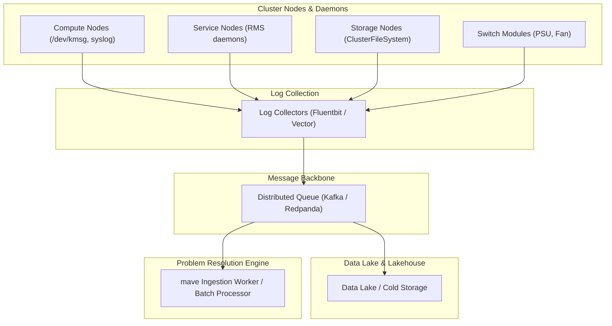
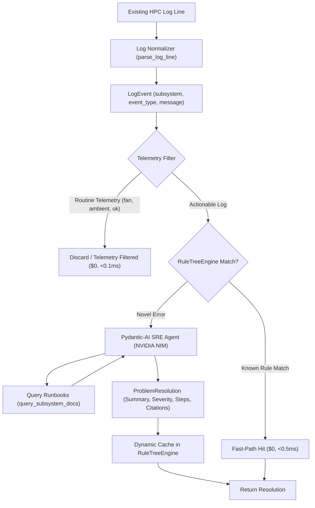
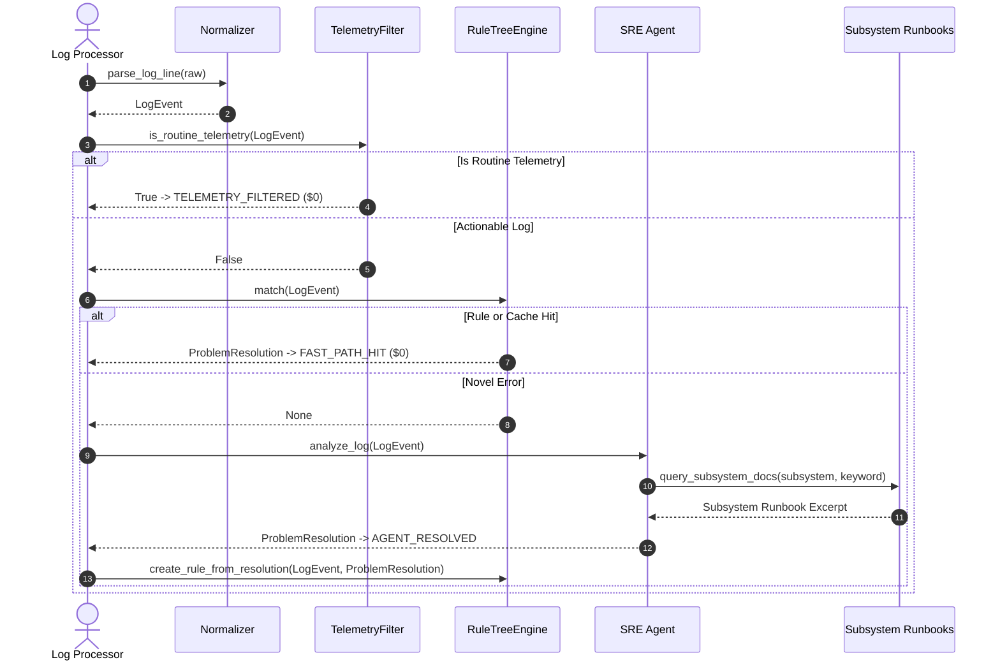
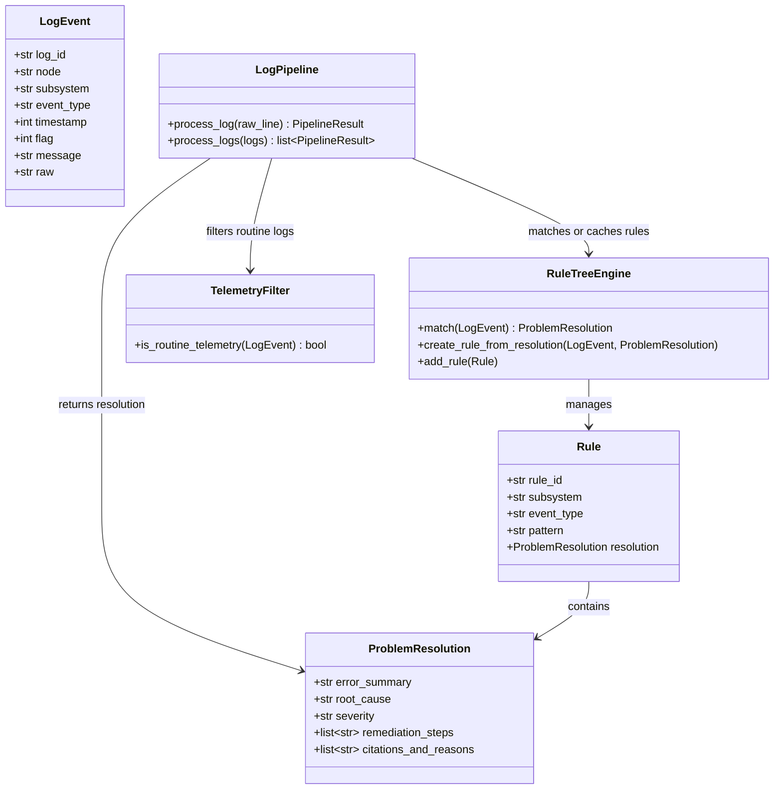

# Design Specification: HPC Log Problem Resolution System

**Date:** 2026-10-10  
**Status:** Approved Specification  
**Target Repository:** `mave`  

---

## 1. Intent & Context

High Performance Computing (HPC) clusters generate large-scale, semi-structured log streams across compute nodes, service daemons, interconnect switches, and shared cluster filesystems. Failures cause job interruptions and downtime.

The dataset used is the 433,490-line benchmark from System 20 at Los Alamos National Laboratory (LANL) (`data/HPC.log`).

The objective is to process existing logs to:
1. Identify errors and differentiate them from routine benign telemetry.
2. Recommend actionable remediation backed by citations and reasons.
3. Adapt to new log formats and templates dynamically (future-proofing).

---

## 2. Ingestion Architecture (Design Only)

Per instructions, data ingestion is designed and diagrammed without background infrastructure deployment.

---

## 3. End-to-End System Architecture

---

## 4. Multi-Stage Pipeline Breakdown

---

## 5. Subsystem Component Relationships

---

## 6. Verification & Quality Plan

- Strict Python 3.12+ standards: `uv run ty check`, `uv run ruff check .`, `uv run ruff format .`
- Automated test coverage: `uv run pytest`
- Batch evaluation: `uv run python main.py --evaluate`
- Demonstration walkthrough: `uv run python main.py --demo`
